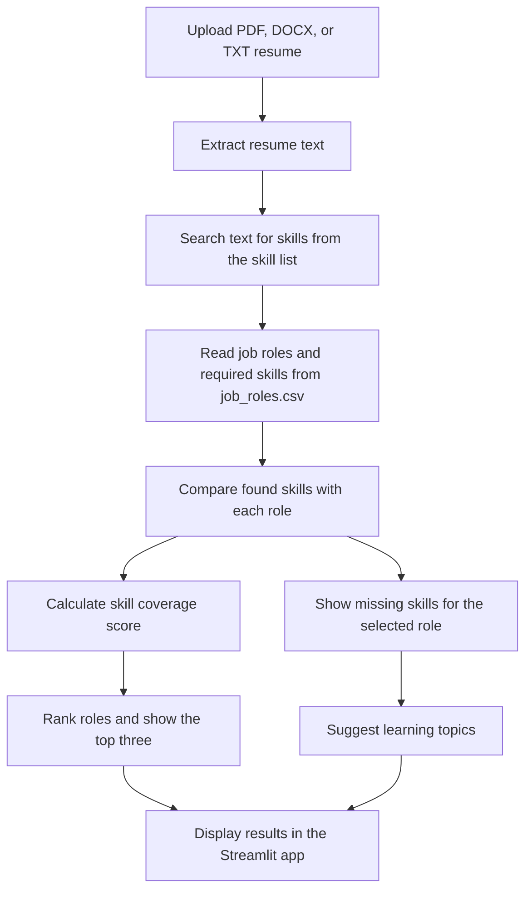

# Project Workflow

## Main parts

- **Streamlit** displays the upload control and results.
- **pypdf** reads text from PDF resumes.
- **python-docx** reads text from DOCX resumes.
- **Keyword matching** finds skills from the app's skill list.
- **job_roles.csv** stores the skills required for each job role.
- **Skill coverage** is the percentage of a role's required skills found in the resume.

The app analyzes the resume for learning guidance. It does not make hiring decisions.